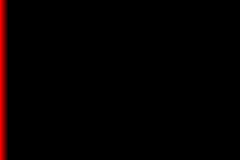
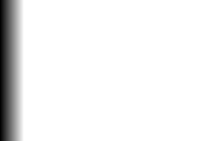
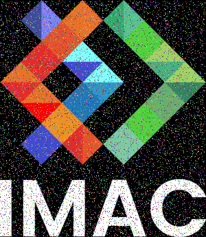
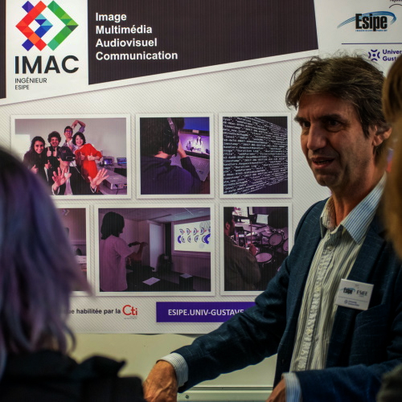
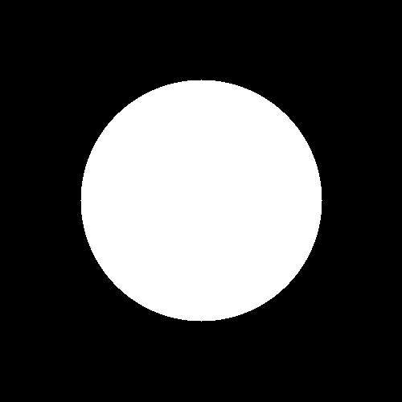
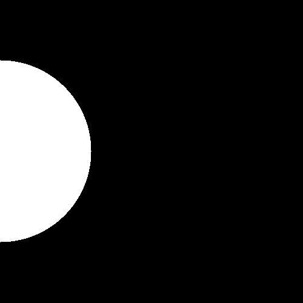

# 🐣 S1 | Prog: Workshop

## ⭐ 1 Star

### Green

### Channel swap

### Black & White - 5 try
Try n°1 :
Tout noir

Try n°2 to 3 :
Tout gris

Try n°4 :
Black and White : color = color.r + color.g + color.b;

Try n°5 :
Source : [transformer une image RGB en niveau de gris](https://www.developpez.net/forums/d534510/general-developpement/algorithme-mathematiques/traitement-d-images/transformer-image-rgb-niveau-gris/)

### Negative

### Gradient - 6 try

## ⭐⭐ 2 Stars

### Mirror
Bug : sil::Image::pixel(int, int): Assertion `x < _width' failed.
J'ai finis par faire x+1 avant de changer pour image.width-1.

### Noisy image

### 90° rotation

### RGB split

### Brightness

### Disk

##### Circle

##### Animation

##### Rose window

### Mosaic
