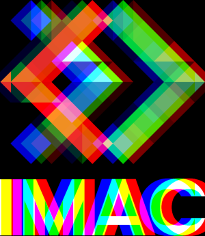
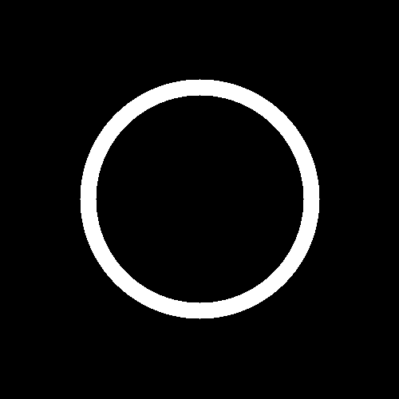
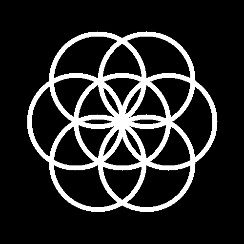

# 🐣 S1 | Prog: Workshop

## ⭐ 1-Star

### Green

### Channel swap

### Black & White
Essai n°1 :
Tout noir

Essai n°2 to 3 :
Tout gris

Essai n°4 :
Black and White : color = color.r + color.g + color.b;

Essai n°5 :
Source : [transformer une image RGB en niveau de gris](https://www.developpez.net/forums/d534510/general-developpement/algorithme-mathematiques/traitement-d-images/transformer-image-rgb-niveau-gris/)

### Negative

### Gradient

## ⭐⭐ 2-Stars

### Mirror 
Error : sil::Image::pixel(int, int): Assertion `x < _width' failed.
J'ai finis par faire x+1 avant de changer pour image.width-1.

### Noisy image

### 90° rotation

### RGB split

### Brightness

### Disk

#####  Circle

##### Animation

## ⭐⭐⭐ 3-Stars

##### Rose window

### Glitch
Error : glm::vec3& sil::Image::pixel(int, int): Assertion `x < _width' failed.
Bug : J'avais mal fait ma condition de boucle : x < vector[0] || p1[0]+x < image.width()
C'était pour proteger une sortie de l'image mais l'effet était autre, et j'ai mis la protection à un autre endroit.

